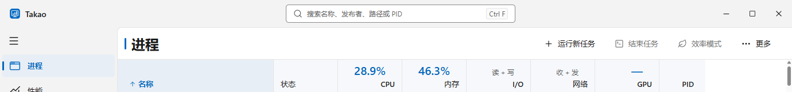

# Takao 名称统一与验收

2026-10-28（Asia/Shanghai）。产品、窗口标题、项目/程序集、命名空间、图标母版、安装器、发布文件及当前文档统一使用 **Takao**。命名与旧版兼容合同见 [工程规范](CONVENTIONS.md)。GitHub 仓库地址继续使用真实的 `1340896123/blue-task-manager`。

文档阶段为 `49f0367`，项目重命名为 `c149607`，迁移修正为 `cd0cdea`；后两者在主工作区分别合入为 `c106836`、`88530e8`。启动状态的并行实现及验收提交完整保留。

## 验证结果

下列 **497 项检查全部通过**，详见 [汇总](evidence/takao-rename/summary.json)。API、浏览器和桌面检查使用生产采集器与真实 Windows 数据，没有模拟业务快照。

| 检查 | 断言数 | 证据 |
|---|---:|---|
| 静态规范 | 3 | [结果](evidence/takao-rename/static-v11.json) |
| 原生 API、真实专用进程及安全保护 | 80 | [结果](evidence/takao-rename/native-api.json) |
| 原生核心操作 | 25 | [结果](evidence/takao-rename/native-core-v11.json) |
| 浏览器页面与专用任务操作 | 36 | [结果](evidence/takao-rename/ui-smoke.json) |
| 真实断线与恢复 | 4 | [结果](evidence/takao-rename/recovery-e2e.json) |
| 正式 Electron、标题、进程操作及退出 | 44 | [结果](evidence/takao-rename/desktop-e2e.json) |
| 八页桌面布局、960/1380、125%及状态 | 248 | [结果](evidence/takao-rename/desktop-layout.json) |
| 旧 EXE 别名实际启动与清理 | 7 | [结果](evidence/takao-rename/legacy-alias.json) |
| 更新附件别名校验边界 | 17 | [结果](evidence/takao-rename/update-metadata.json) |
| 提升后的独立 NSIS 迁移机制 | 33 | [结果](evidence/takao-rename/installer-migration.json) |

原生核心、浏览器、恢复及旧入口检查在 `c149607` 执行；迁移修正后重新验证了生产 API、正式 Electron 与全部桌面布局。更新元数据检查直接调用最终发布 DLL 的生产校验代码，输入为明确标注的算法 fixture。NSIS 检查使用独立产品键、目录和测试程序；真实产品安装记录及完整 IFEO 配置指纹均保持不变。

Electron 测试分别读回 HTML title、可见顶部名称与 Windows 原生窗口标题，均为 `Takao`。下图裁切自真实 1380×860 桌面截图，仅展示命名和界面顶部：



布局测试为自身临时目录写入完整合法的偏好，明确跳过无关的首次接管提示，并校验没有偏好恢复警告；采样状态选择器按具体文字区分系统与逐进程网络状态。生产首次提示行为没有因此修改。

## 构建与复现

TypeScript 检查、Vite 生产构建、锁定依赖恢复、solution Release、独立 DiskTests/UpdateProbe 构建、生产 NSIS `/WX` 编译、actionlint、JavaScript 与 PowerShell 语法检查均通过。使用本机已缓存的官方 SDK 10.0.401，`global.json` 和依赖版本保持原有锁定值；自包含运行时为 .NET/ASP.NET 10.0.12，Electron 为 45.0.0。

普通构建使用 README 中的入口。本机固定 SDK 可按以下方式调用：

```powershell
npm run typecheck
npm run build
& .\output\tools\network-sdk-10.0.401\dotnet.exe restore Takao.sln --locked-mode --ignore-failed-sources -p:NuGetAudit=false
& .\output\tools\network-sdk-10.0.401\dotnet.exe build Takao.sln -c Release --no-restore -p:ElectronSkipExecCommands=true
```

以下测试需要真实提升令牌，工作区中须已组装 `output/Takao-win-x64`：

```powershell
powershell -NoProfile -ExecutionPolicy Bypass -File tests/windows-layout-worker.ps1 -Suites static-v11,native-api,native-core-v11,ui-smoke,recovery-e2e,windows-layout,desktop-e2e -Desktop
node docs/evidence/takao-rename/legacy-alias-smoke.mjs
& .\tests\Takao.UpdateProbe\bin\Release\net10.0-windows10.0.19041.0\Takao.UpdateProbe.exe metadata .\output\Takao-win-x64 .\output\takao-update-metadata.json
powershell -NoProfile -ExecutionPolicy Bypass -File scripts/test-update-installer.ps1 -MakeNsisPath C:\nsis\makensis.exe
```

完整截图由测试生成到 `output/playwright`；本轮本地副本保存在 `output/takao-rename/playwright`。只清理测试创建的进程身份、端口、ETW 会话和独立安装目录，没有修改用户真实启动项或接管系统入口。

## 兼容与未执行范围

新安装默认目录及快捷方式为 Takao。旧安装注册键、标记、用户偏好目录、受保护暂存、应用身份和 HTTP 合同继续兼容；两个旧 EXE 是加载 Takao DLL 的同字节 apphost 别名。升级和卸载只删除清单中的八个旧组件，并保留用户额外文件。

发布时保留已独立验收的交付文件，再生成新旧安装器文件名的同内容附件。旧客户端可识别旧名，新客户端只在两个精确名称的大小、合法摘要、官方 URL 和各自校验行均一致时接受别名。不同内容、重复名称及异常校验条目仍拒绝。

本轮没有执行真实 GitHub Release 发布、官方在线下载或替换用户正在使用的正式安装目录。当前外网 HTTPS 出现 TLS/EOF 连接错误，在线漏洞数据审计未完成；本地依赖锁恢复和构建已通过。算法与独立安装机制结果不替代这些在线成功证据。
